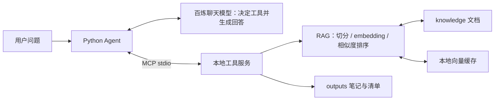

# 本地知识库助手：LLM + MCP + RAG

一个便于逐步阅读的小型 Python 命令行项目。使用百炼模型，根据本地文档回答问题，并通过真实 MCP stdio 服务读取文档、检索和保存清单。支持单次提问和多轮对话。

## 学习目标

在 [阶段 03](../03LLM%2BTool%20Calling/README.md) 中，Python 直接调用本地函数。本阶段将工具放入独立进程，通过 MCP 发现和调用它们，并增加 RAG 检索，让回答能够引用文档依据。

阅读前需要了解 Python 函数、JSON 和工具调用的消息流程；遇到 `async` / `await` 时，可以先关注“等待模型或工具返回结果”这一作用，再深入异步实现。运行后应能解释：检索怎样找到相关片段，来源编号如何进入回答，以及 MCP 与直接调用函数有什么区别。

## 快速开始

需要 Python 3.11+。在本目录创建虚拟环境并安装依赖：

```powershell
python -m venv .venv
.\.venv\Scripts\python.exe -m pip install -r requirements.txt
```

### 先运行不需要密钥的模式

```powershell
.\.venv\Scripts\python.exe main.py "知识库支持哪些文档？" --search keyword --retrieve-only
.\.venv\Scripts\python.exe main.py --list-tools
```

第一条命令会输出匹配的文档片段及来源，来源形如 `project.md#片段2`；片段编号以实际输出为准。关键词模式的分数字段显示为 `None`，它不计算向量相似度。第二条命令会列出四个 MCP 工具：`list_documents`、`read_document`、`search_documents`、`save_note`，随后退出。两种模式均不请求模型服务。

### 再接入模型服务

复制模板并编辑 `.env`（已有配置时跳过复制）：

```powershell
Copy-Item .env.example .env
```

填写 API 密钥，并按账号地域和权限调整服务地址与模型。完整聊天需要聊天模型；默认向量检索还需要 embedding 模型的调用权限。完成后启动：

```powershell
.\.venv\Scripts\python.exe main.py
```

启动后可以依次提问：

```text
知识库里有哪些文档？
这个知识库支持哪些文件格式？请给出来源。
读取 tasks.md，把学习任务整理成清单并保存为 my_tasks.md。
```

观察回答中的文件名和来源编号，并回到 `knowledge/` 核对内容。保存成功后应能在 `outputs/my_tasks.md` 找到清单；再次使用相同文件名会失败，需要更换名称。

支持 `/tools` 查看工具、`/clear` 清空当前对话、`/exit` 退出。历史只保留在当前进程内，最多保留最近 8 个完整用户轮次，不写入磁盘。Ctrl+C 也可退出。

单次运行：

```powershell
.\.venv\Scripts\python.exe main.py "查一下项目有哪些学习任务，并注明资料来源"
```

MCP 服务会自动启动和关闭，不需要手动开启第二个终端。终端中的 `[MCP] 调用 ...` 表示真实工具调用；加 `--quiet` 可隐藏这些提示。

## 依赖与解释器

```powershell
.\.venv\Scripts\python.exe -m pip install -r requirements-lock.txt
```

`requirements.txt` 定义直接依赖及版本范围；`requirements-lock.txt` 记录 Windows / Python 3.13 环境的完整依赖版本，可用上面的命令复现该环境。其他平台优先使用 `requirements.txt` 安装：

```powershell
.\.venv\Scripts\python.exe -m pip install -r requirements.txt
```

VS Code 中通过 `Python: Select Interpreter` 选择 `.venv\Scripts\python.exe`。

## 配置

程序读取本目录的 `.env`，也支持通过进程环境变量配置；已有环境变量优先于 `.env`。仓库仅提供不含密钥的 `.env.example`：

| 变量 | 用途 |
| --- | --- |
| `DASHSCOPE_API_KEY` | 百炼 API 密钥 |
| `BAILIAN_BASE_URL` | 当前账号地域对应的 OpenAI 兼容接口基础地址 |
| `BAILIAN_MODEL` | 支持 function calling 的聊天模型 |
| `BAILIAN_EMBEDDING_MODEL` | 向量模型，默认 `text-embedding-v4` |

聊天与 embedding 共用密钥及地址，需要账号在对应地域有调用权限。示例中的模型名和地址应按实际账号调整。密钥不会打印，也不会写入缓存或对话文件。

可以通过环境变量 `KNOWLEDGE_DIR`、`OUTPUT_DIR`、`CACHE_DIR` 指定数据目录；默认均位于本项目内。

## 三部分如何配合



- **LLM**：理解问题，决定调用什么工具，根据工具结果回答。
- **RAG**：将问题与文档向量化，检索相关片段，提供回答依据。
- **MCP**：让 Agent 通过标准协议发现和调用独立进程里的工具。

默认聊天模式中，RAG 作为 MCP 的 `search_documents` 工具提供给 LLM。模型发出 tool call 后，Python 执行 MCP 调用、回传结果，再请求模型继续，最多 6 轮。模型可能在已获取足够资料时直接使用对话中的资料。

## 文件结构与阅读顺序

| 文件 | 职责 |
| --- | --- |
| `config.py` | 加载配置，创建模型客户端 |
| `rag.py` | 文档读取、段落切分、关键词检索、来源编号 |
| `vector_search.py` | embedding、余弦相似度、文档向量缓存 |
| `knowledge_service.py` | 统一检索业务，供 CLI 和 MCP 使用 |
| `tool_server.py` | 用 FastMCP 暴露工具 |
| `mcp_connection.py` | 启动服务、握手、管理 stdio 连接 |
| `agent.py` | 工具定义转换、模型决策循环、历史裁剪 |
| `main.py` | 命令行入口与交互模式 |
| `tests/test_project.py` | 离线测试及真实 MCP 协议集成测试 |
| `knowledge/` | UTF-8 `.md`、`.txt` 文档，支持子目录 |
| `.cache/` | 自动生成的文档向量，可删除以重建 |
| `outputs/` | 工具保存的笔记和清单 |

推荐按表中从 `config.py` 到 `main.py` 的顺序阅读。每次只看一个文件，再运行相应模式观察结果。

也可以沿一次请求追踪：`main.py` 接收问题，`agent.py` 请求模型并执行工具调用，`mcp_connection.py` 提供连接，`tool_server.py` 接收请求，`knowledge_service.py` 调用检索，再将结果逐层返回模型。模型根据结果组织最终回答。

## 学习与对比模式

```powershell
# 1. 只体验 LLM
.\.venv\Scripts\python.exe main.py "用一句话解释 RAG" --llm-only

# 2. 只看关键词检索，不联网调用模型
.\.venv\Scripts\python.exe main.py "知识库支持哪些文档？" --search keyword --retrieve-only

# 3. 只看向量检索：会调用 embedding，不调用聊天模型
.\.venv\Scripts\python.exe main.py "我能把什么格式的资料放进来？" --retrieve-only

# 4. 通过真实 MCP 发现工具，不调用模型
.\.venv\Scripts\python.exe main.py --list-tools

# 5. 完整 Agent，提示模型用关键词检索
.\.venv\Scripts\python.exe main.py "项目的学习任务有哪些？" --search keyword
```

默认使用向量检索。完整 Agent 中 `--search` 提供给模型作为检索方式指示；模型实际选用的工具参数由其决策。要确定性对比两种检索结果，使用 `--retrieve-only`。

| 模式 | 需要密钥 | 主要观察内容 |
| --- | --- | --- |
| `--search keyword --retrieve-only` | 否 | 匹配词语与返回片段的关系 |
| `--list-tools` | 否 | MCP 服务实际暴露的工具及说明 |
| `--llm-only` | 是，调用聊天模型 | 未检索本地文档时，模型如何回答 |
| `--retrieve-only` | 是，调用 embedding 模型 | 文档片段的向量相似度与排序 |
| 默认聊天模式 | 是 | 工具调用、检索结果与带来源的回答 |

## 动手实验与自检

1. 用相同问题分别执行关键词检索和向量检索，比较返回片段；再换成意思接近但用词不同的问题，观察排序如何变化。
2. 向 `knowledge/` 添加一份不含个人信息的 UTF-8 文档，写入几条明确事实，重新检索并核对来源。向量模式会将新增片段发送给 embedding 服务。
3. 要求助手读取 `tasks.md` 并保存清单，然后查看生成文件；再次保存同名文件，观察工具如何处理冲突。

自检：找到相关片段是否就意味着答案正确？为什么问题和文档应使用同一个向量模型？MCP 负责的是检索算法，还是工具的发现与调用？

## MCP 工具

| 工具 | 行为 |
| --- | --- |
| `list_documents` | 列出知识库的 `.md` 和 `.txt` 文档 |
| `read_document` | 读取知识库内文档，单文件最多 100 KB |
| `search_documents` | 向量或关键词检索，返回片段、来源和分数 |
| `save_note` | 保存 `.md` / `.txt` 到 outputs，不允许覆盖已有文件 |

读文件会校验解析后的路径，拒绝越出知识库。保存工具只接受简单文件名。Agent 仅在当前用户请求包含保存、导出等意图词时放行保存，模型同时受到系统提示约束。它是本地学习项目中的简单防误写措施，不是完整的权限或意图识别系统。

`outputs/` 在首次保存时自动创建，生成的笔记不纳入版本控制。再次保存同名文件会失败，需要使用新的文件名。

可参考 [学习清单示例](examples/demo_checklist.md) 了解保存结果的格式。该示例为公开学习资料，实际运行输出仍保存在 `outputs/`。

## RAG 与缓存细节

- 文档按空行分段，长段落每片最多 500 字，重叠 80 字。
- 关键词模式：英文单词、中文相邻双字，按共享词语数量排序。
- 向量模式：问题和片段使用同一 embedding 模型，按余弦相似度取前 3 个片段。
- 文档向量缓存在 `.cache/embeddings.json`，正文、模型、服务地址改变时重新计算。新增文档下次检索会被读取。
- 相同片段复用缓存；问题向量每次生成。损坏的 JSON 缓存会自动重建。
- 缓存只存哈希键和数字向量，不存密钥或文档正文；旧文档向量可能保留，清理缓存即可移除。
- 无向量数据库，所有片段在内存中排序，适合小型学习资料集。

首次向量检索会把全部文档片段发送给 embedding 服务，之后仅发送新增或修改片段；问题每次发送。选中的片段或读取的文档会发送给聊天服务。模型调用按服务商规则消耗额度。

相似度不是置信度；当前没有经过评估的拒答阈值，无关问题也可能检索到片段。系统提示要求资料不足时说明，但不能保证模型从不编造，应核对引用。文档输入限于 Markdown 和 TXT；PDF、Word、图片、联网搜索或持久化对话需要额外实现。

## 验证与排错

离线测试不需要调用模型：

```powershell
.\.venv\Scripts\python.exe -m unittest discover -s tests -v
.\.venv\Scripts\python.exe -m pip check
```

测试覆盖切分与检索、余弦输入校验、缓存复用与失效、历史完整性、路径边界、不覆盖文件，以及通过真实 stdio 进程执行四个 MCP 工具。测试文件保存在临时目录，不修改项目知识库。

- 缺少包：确认解释器是 `.venv`，并重新安装依赖。
- HTTP 401/403：检查密钥及账号权限；404/400：检查接口地址、模型名、模型工具调用支持。
- 向量检索失败：检查 embedding 模型和地域，先切换关键词模式定位问题。
- 知识库为空或读取失败：检查文件格式、UTF-8 编码和目录权限。
- 保存提示已存在：换一个文件名，工具不会覆盖已有笔记。
- `--list-tools` 失败：先检查 MCP SDK 是否安装，服务文件是否完整。

参考：[MCP Python SDK v1](https://py.sdk.modelcontextprotocol.io/v1/)、[百炼 Embedding 接口](https://help.aliyun.com/zh/model-studio/embedding-interfaces-compatible-with-openai)。项目固定 `mcp<2`，避免跨主版本 API 变化。
